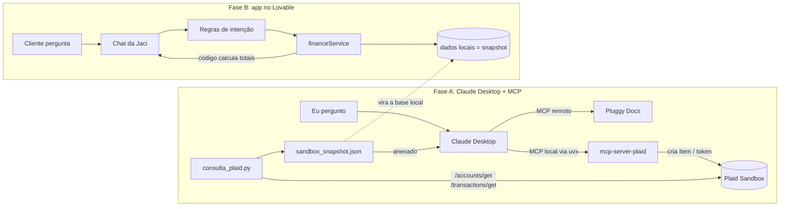

# Banco Jangada · Jaci, assistente financeira com MCP

> **Demonstração educacional. Todos os dados bancários são fictícios** (Plaid Sandbox).
> "Banco Jangada" é uma marca inventada para este projeto e não representa nenhuma instituição real.

**App publicado:** https://banco-jangada.lovable.app

Projeto do desafio **"MCP sem complicação: Open Finance com Pluggy e Plaid Sandbox"** (DIO, Expert Bruno Lima). Refiz o caminho da aula no **Windows**, usando o **Claude Desktop** como cliente MCP (no curso foi o Codex, no Mac), e publiquei um chat no **Lovable** em que a assistente **Jaci** responde, em português, sobre contas, saldos e transações.

---

## 1. Onde o cliente já está e o que a Jaci responde

**Cenário:** o próprio app do banco. O cliente abre o chat do Banco Jangada e pergunta em linguagem natural, sem precisar navegar por extratos e telas de saldo.

| A Jaci responde | Exemplo de pergunta |
|---|---|
| Contas, tipos e moeda | "Mostrar minhas contas" |
| Saldos, separando **dinheiro, investimentos, dívidas e limites** | "Consultar meus saldos" |
| Últimas transações | "Ver minhas últimas transações" |
| Gastos por **categoria**, **mês**, **conta** ou **intervalo de datas** | "Gastos de outubro", "Quanto gastei com alimentação?" |
| Resumo de entradas e saídas | "Resumir minhas movimentações" |
| Valores também em **reais**, com a conversão declarada | interruptor "Mostrar em reais" |

O app é **somente leitura**: pedidos de Pix, pagamento ou transferência recebem a explicação de que é uma demonstração. Perguntas fora do escopo recebem sugestões válidas, sem números inventados.

### De onde vem cada dado

| Dado | Origem | Como chegou |
|---|---|---|
| Conceitos (Item, conta, transação) e endpoints da integração brasileira | **Pluggy**: documentação | MCP remoto `https://mcp.pluggy.ai/mcp` |
| Criação do Item de teste | **Plaid Sandbox** | MCP local `mcp-server-plaid`, ferramenta `get_sandbox_access_token` |
| 14 contas e saldos | **Plaid Sandbox**, instituição de teste First Platypus Bank (`ins_109508`) | `POST /accounts/get` via [`scripts/consulta_plaid.py`](scripts/consulta_plaid.py) |
| 48 transações (22/08 a 19/11/2026) | **Plaid Sandbox** | `POST /transactions/get`, com paginação, via o mesmo script |
| Base local do app | [`dados/sandbox_snapshot.json`](dados/sandbox_snapshot.json), sem credenciais | colado na especificação do Lovable |
| Cotação USD→BRL | PTAX de 13/11/2026 (R$ 5,65), Banco Central | taxa fixa e declarada no app |

> A Plaid é só um **laboratório**: não representa o Open Finance brasileiro, que em produção exige consentimento, escopo, revogação e segurança próprios.

---

## 2. O caminho de uma pergunta



1. **Pergunta:** "qual é o meu saldo?"
2. **Ferramenta:** na Fase A, o Claude escolhe uma ferramenta MCP (documentação ou criação do Item). No app, uma regra identifica a intenção "saldos".
3. **Endpoint:** os dados vêm de `POST /accounts/get` da Plaid Sandbox, gravados no snapshot.
4. **Cálculo:** o **código** soma os grupos (dinheiro, investimentos, dívidas). A IA não inventa números.
5. **Resposta:** a Jaci apresenta tabela e cartões, com período, quantidade de registros e o aviso de dados fictícios.

### Por que o saldo do cartão aparece como dívida

Na Plaid, contas `credit` e `loan` trazem em `balances.current` **quanto se deve**, e em `available`/`limit` o **limite de crédito**, não dinheiro. Por isso o app **nunca soma as 14 contas como patrimônio**:

| Grupo | Saldo atual (US$) |
|---|---|
| Dinheiro (depository) | 62.589,00 |
| Investimentos (IRA, 401k) | 23.952,74 |
| Dívidas (cartões e empréstimos) | 163.705,89 |

E, nas transações, **valor positivo é saída e negativo é entrada**.

---

## 3. Como configurar os servidores MCP (Windows + Claude Desktop)

### 3.1 Pluggy (remoto, sem chave)

Claude Desktop → **Configurações → Conectores → Adicionar conector personalizado**
- Nome: `pluggy`
- URL: `https://mcp.pluggy.ai/mcp`
- Autenticação: vazia (só documentação)

### 3.2 Plaid (local, STDIO)

1. **Chaves:** dashboard.plaid.com → **Build → Keys** → copiar o *Client ID* e o *Secret* de **Sandbox**.
2. **Instalar o uv** (PowerShell):
   ```powershell
   powershell -ExecutionPolicy ByPass -c "irm https://astral.sh/uv/install.ps1 | iex"
   # fechar e reabrir o PowerShell
   uv --version
   where.exe uvx      # no PowerShell, "where" sozinho é outro comando
   ```
3. **Configurar:** Claude Desktop → menu ☰ → **Arquivo → Configurações → Desenvolvedor → Editar configuração**. O arquivo `claude_desktop_config.json` **já tem conteúdo** (preferências do app): adicione `mcpServers` **dentro** do objeto existente, sem criar um segundo `{ }`.
   ```json
   "mcpServers": {
     "plaid": {
       "command": "C:\\Users\\SEU_USUARIO\\.local\\bin\\uvx.exe",
       "args": ["mcp-server-plaid"],
       "env": {
         "PLAID_CLIENT_ID": "COLE_SEU_CLIENT_ID",
         "PLAID_SECRET": "COLE_SEU_SANDBOX_SECRET"
       }
     }
   }
   ```
4. **Reiniciar de verdade:** botão direito no ícone da bandeja → **Sair**, e abrir de novo. Fechar a janela não recarrega a configuração.
5. **Conferir:** em Configurações → Desenvolvedor, o servidor `plaid` aparece **"Em execução"**. Os testes rodam no **modo Chat**, não no modo Code.

### 3.3 Uma diferença importante em relação ao curso

O `mcp-server-plaid` expõe 4 ferramentas: `search_documentation`, `get_mock_data_prompt`, `get_sandbox_access_token` e `simulate_webhook`. **Nenhuma lê contas ou transações.** No curso, o Codex escreveu e rodou um programa local para isso. O Claude Desktop, no modo Chat, não executa código na máquina, então criei o [`scripts/consulta_plaid.py`](scripts/consulta_plaid.py):

- usa só a biblioteca padrão do Python e lê as chaves de um `.env` local, que não é versionado;
- consulta **apenas** `https://sandbox.plaid.com`;
- percorre todas as páginas de `/transactions/get` (`count`/`offset`/`total_transactions`);
- repete até 3 vezes em `PRODUCT_NOT_READY`;
- grava um JSON **sem token, sem credenciais e sem IDs internos**, já marcando a natureza de cada conta (dinheiro, investimento ou dívida) e o sinal de cada transação.

```powershell
copy .env.example .env      # preencher as chaves de Sandbox
uv run scripts\consulta_plaid.py --criar-item   # 1ª vez: cria o Item e grava o token no .env
uv run scripts\consulta_plaid.py                # próximas vezes
```

### 3.4 Problemas que encontrei e como resolvi

| Sintoma | Causa | Solução |
|---|---|---|
| "Unexpected non-whitespace character after JSON" ao abrir o app | colei um segundo objeto `{ }` depois do conteúdo existente | mesclar `mcpServers` dentro do objeto raiz |
| Servidor não sobe | caminho do `uvx` ainda com `SEU_USUARIO` | usar o caminho exato de `where.exe uvx`, com `\\` |
| Não achei "Desenvolvedor" | eu estava no painel da Plaid, não no Claude Desktop | ☰ → Arquivo → Configurações → Desenvolvedor |
| Conectores não apareciam | app aberto no **modo Code** | trocar para o **modo Chat** (ícone de balão) |
| Sem ferramenta para ler contas | limitação do `mcp-server-plaid` | script local de consulta (3.3) |

---

## 4. Evidências

### Fase A: MCP no Claude Desktop

| | |
|---|---|
| Conectores ativos |  |
| Pluggy: endpoints de Transaction (`/transactions` descontinuado, `/v2/transactions` atual) |  |
| Plaid: documentação de Item, `/accounts/get` e `/transactions/get` |  |
| Plaid: Item de Sandbox criado pelo MCP (token não exibido) |  |
| Script: 14 contas e 48 transações consultadas |  |
| Tabela de contas |  |
| 5 transações mais recentes e saídas por categoria |  |
| 3 padrões de gasto |  |

### Três padrões de gasto (90 dias, 48 transações confirmadas, valores em US$)

| Categoria | Registros | Saídas (US$) |
|---|---|---|
| Transferências de saída | 6 | 20.550,00 |
| Pagamentos de empréstimos/dívidas | 6 | 6.310,50 |
| Alimentação e bebidas | 9 | 1.548,99 |
| Transporte | 9 | 1.535,19 |
| Viagens | 3 | 1.500,00 |
| Aluguel e contas | 3 | 1.500,00 |
| Mercadorias em geral | 3 | 268,20 |
| Cuidados pessoais | 3 | 235,50 |

1. **Transferências e dívidas dominam:** juntas somam US$ 26.860,50, cerca de 80% das saídas (US$ 33.448,38). O consumo, sem essas duas categorias, é de US$ 6.587,88. Transferência não é tratada como consumo.
2. **Os gastos se repetem todo mês:** os mesmos estabelecimentos aparecem a cada ~30 dias com o mesmo valor (KFC, Madison Bicycle Shop, Tectra Inc, United Airlines...). É um padrão típico do conjunto fictício do Sandbox, não um hábito real.
3. **Alimentação concentrada:** dos US$ 1.548,99 em alimentação, US$ 1.500,00 vêm de três compras de US$ 500,00 no KFC.

**Rótulos estranhos do Sandbox:** "ACH Electronic CreditGUSTO PAY" e "AUTOMATIC PAYMENT - THANK" têm nome de crédito, mas vêm com valor positivo, ou seja, saída. O app segue o sinal e a categoria e **não afirma que algo é renda**.

### Fase B: app no Lovable

| | |
|---|---|
| Especificação enviada ao Lovable |  |
| Tela inicial, com o aviso de dados fictícios |  |
| Contas |  |
| Gastos por categoria |  |
| Gastos |  |
| Resumo das movimentações |  |

---

## 5. Especificação enviada ao Lovable e o que ajustei depois

O prompt completo está em [`docs/prompt-lovable.md`](docs/prompt-lovable.md). É uma adaptação das páginas 25 a 28 do guia da aula, com estas mudanças:

- **Dados reais do meu Sandbox** (14 contas e 48 transações do snapshot) no lugar da amostra de 4 contas do guia;
- **Totais esperados** dentro do prompt, para o próprio Lovable conferir os cálculos;
- **Marca e personagem próprios** (Banco Jangada e Jaci, com azul-marinho, branco e areia);
- **Interpretação por regras** na Etapa 1: o código calcula, e nenhuma IA externa é chamada;
- **Camada `financeService` substituível**, para a Etapa 2 trocar só a fonte dos dados.

**O que aconteceu e o que foi ajustado:**
- O Lovable **não abriu o modo Chat** para tirar dúvidas e construiu direto a partir da especificação.
- Ele corrigiu sozinho erros de build e manteve um teste automático conferindo os "Totais esperados".
- Na revisão em tela de celular, ele trocou as tabelas por **cartões empilhados** e ajustou o texto do campo de mensagem para "Pergunte à Jaci…".
- Eu conferi manualmente as respostas (contas, categorias, alimentação, outubro, Pix recusado e o interruptor de reais) contra os valores calculados do JSON.

---

## 6. Melhorias escolhidas

1. **Valores também em reais, com a conversão declarada:** o interruptor "Mostrar em reais" usa uma taxa **fixa e visível** (R$ 5,65, PTAX de 13/11/2026, Banco Central), com aviso de que é uma conversão ilustrativa, não uma cotação em tempo real. A moeda original (USD) sempre é preservada.
2. **Perguntas novas:** gastos por **categoria**, por **mês**, por **conta** e por **intervalo de datas** ("de 01/09 a 30/09").
3. **Snapshot reproduzível:** o script gera a base do app direto da API do Sandbox, sem nenhum segredo no arquivo.

---

## 7. Segurança

- Nenhuma chave, secret ou token está versionado: o `.env` está no `.gitignore`, e o [`.env.example`](.env.example) traz só os nomes das variáveis.
- O snapshot não tem token, `item_id` nem `account_id`.
- Os prints foram feitos com os resultados das ferramentas recolhidos, sem exibir o token.
- O app não pede credenciais e não faz nenhuma operação de escrita.
- Boa prática aprendida: se um secret aparecer em algum lugar indevido, **rotacione no painel da Plaid** (Build → Keys) antes de continuar.

---

## 8. Próximos passos

- **Etapa 2:** backend no Lovable Cloud com `PLAID_CLIENT_ID`, `PLAID_SECRET` e `PLAID_ACCESS_TOKEN` só no servidor, consultando a Plaid em tempo de execução.
- **Webhooks** (`SYNC_UPDATES_AVAILABLE`) para avisar o cliente por push ou WhatsApp.
- Transformar a configuração dos servidores numa **skill de agente**.

---

## 9. Estrutura do repositório

```
├── README.md
├── .env.example                 # nomes das variáveis (sem valores)
├── dados/
│   └── sandbox_snapshot.json    # 14 contas + 48 transações fictícias, sem segredos
├── docs/
│   ├── prompt-lovable.md        # especificação enviada ao Lovable
│   └── prints/                  # evidências (01 a 14)
├── scripts/
│   └── consulta_plaid.py        # consulta ao Plaid Sandbox
└── src/                         # código do app gerado pelo Lovable
```

---

**Autor:** Leonardo Paixão · [github.com/leopxz](https://github.com/leopxz)
Desafio da DIO, com base na aula do Expert Bruno Lima. Fontes: [Pluggy MCP](https://docs.pluggy.ai/pt/docs/developer-tools/mcp) · [Plaid Sandbox](https://plaid.com/docs/sandbox/) · [Plaid MCP (ai-coding-toolkit)](https://github.com/plaid/ai-coding-toolkit/blob/main/sandbox/README.md) · [API de transações da Plaid](https://plaid.com/docs/api/products/transactions/) · [uv](https://docs.astral.sh/uv/getting-started/installation/)
